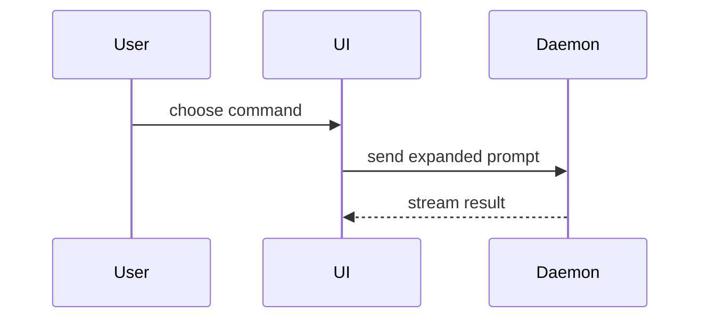

## 跨宿主适配（AgentBase）

本技能在 WorkBuddy / CodeBuddy / DSH 三处共用。文中若出现某一宿主专用的工具名，按当前环境等价替换：

| 文中写法 | 你的环境里应理解为 |
|---|---|
| `Read` | 读取文件（用你所在宿主的读文件工具） |
| `Write` / `Edit` | 写入或修改文件 |
| `Bash` | 执行 shell 命令 |
| `Grep` / `Glob` | 搜索文件内容 / 按模式找文件 |
| `Task` | 起子代理（环境不支持则串行完成） |
| `WebFetch` | 抓取网页 |

技能名同理：当前宿主没有的技能，跳过并在结果中说明，不要假装调用过。
Use this template for writing the PR body:

```markdown
## Summary

<diagram, diff-sketch, or tree>

## Evidence

- **Before:** <screenshot/output/failing test run>
  **After:** <screenshot/output/passing test run>

## Merge Danger

**Door:** <one-way or two-way>

<optional: description>

**Blast Radius:** <one-word description>

<optional: potential ramifications of merge>
```

## Sections

Skip all preambles and keep prose brief. Use the user's domain language from `GLOSSARY.md`.

### Summary

Pick the smallest view that makes the key point clear.

- Show logic or an algorithm as pseudocode:

```text
on(save)
  if content is unchanged
    return cached result
  write new content
  return fresh result
```

- Show runtime control flow as a call tree:

```text
submitForm
  createSession
    persistPrompt
    launchAgent
  navigateToSession
```

- Show UI structure as a component tree, including state and module boundaries that matter:

```text
<SessionPage> (apps/example/src/routes/session.tsx)
  useSessionEvents()
  <SessionToolbar>
    <RunSkillButton> (packages/ui)
```

- Show file responsibility or a broad refactor as a shallow file tree:

```text
src/
├── commands/       # parses user actions
├── sessions/       # owns session state
└── transport/      # sends API requests
```

- Show component interaction, control flow, or data flow with Mermaid:



- Use `diff` when the point is what changes and the surrounding shape already exists. Match the diff shape to the topic.

For a component change:

```diff
 <SessionPage>
   useSessionEvents()
   <SessionToolbar>
+    <RunSkillButton />
   <SessionTimeline>
+    <SkillResultCard />
```

For a file-layout change:

```diff
 src/
 ├── commands/
+│   └── show-me.ts       # expands the slash command
 ├── sessions/
-└── transport.ts
+└── transport/
+    ├── client.ts
+    └── stream.ts
```

For a call-tree or call-stack change:

```diff
 submitForm
   createSession
     persistPrompt
+    expandSkillMention
     launchAgent
-  navigateToSession
+  navigateToSession
+    subscribeToEvents
```

For a state or control-flow change:

```diff
 on(save)
-  write content
+  if content is unchanged
+    return cached result
+  write new content
+  invalidate cache
```

- Show the whole block when most of it is new, when omitted context would hide ownership or order, or when the user needs a copyable target shape:

```ts
function expandSkill(command: string): string {
  const skillName = command.slice(1);
  return `use the ${skillName} skill`;
}
```

#### Guidance

Place each visual next to the short text it supports. Keep only the calls, files, props, states, and boundaries needed to answer the user's current question or the options to resolve the current discussion point.

You may use one of these, you may use several, it is unlikely you will use all of them. Use your judgement and don't overwhelm the user.

### Evidence

Concrete evidence that the change works. Show a before and after.

Screenshots are S-tier - when the environment is set up for it and the change is visual.

Execution-based evidence is A-tier. Test results, console output. Show the exact test that now fails and passes, using pseudocode.

### Merge Danger

Describe whether it's a one-way or two-way door. You can walk back through two-way doors, but not one-way doors. A PR that is cheap to roll back is lower risk. Changes that involve destructive actions or hard-to-reverse decisions are one-way doors.

The blast radius is the potential impact or scope of the changes introduced by this PR. Consider all possibilities. Examples are layout shift, breakages for consumers, mobile responsiveness, etc.

## CodeBuddy environment notes

Tool mapping for this environment (use these, not Claude Code names):

| Purpose | CodeBuddy tool |
|---|---|
| Load another skill | `use_skill` with `command: "<skill-name>"` |
| Delegate exploration / parallel work | `task` with `subagent_name: "code-explorer"`; multiple named teammates for team mode |
| Ask the user structured questions | `ask_followup_question` |
| Track work | `todo_write` |
| Read / write / edit files | `read_file`, `write_to_file`, `replace_in_file` |
| Search | `search_file`, `search_content`, `list_dir` |
| Shell | `execute_command` (PowerShell on Windows: no `grep`/`cat`/`&&` chaining) |
| Web | `web_search`, `web_fetch` (look them up with `ToolSearch`, then call via `DeferExecuteTool`) |
| Lint / diagnostics | `read_lints` |

- There is no `Task`-style background agent, no `AskUserQuestion`, and no `/clear` or `/compact` command. To free context, start a new session and hand over via the `handoff` skill.
- Project instructions: `CODEBUDDY.md` (or `AGENTS.md` when no `CODEBUDDY.md`). Project rules: `.codebuddy/rules/<name>/RULE.mdc`.
- `gh` / `glab` may not be installed and `git` may be absent. Always probe first with `git --version` / `gh --version`; when unavailable, use the local-markdown tracker (`.scratch/<feature>/issues/`) instead of failing.
- Git-only mechanics (worktrees, integration branches, PR links) degrade to sequential single-branch work when git is unavailable.
- `*.sh` templates in this skill folder are bash. On Windows, port them to PowerShell before use.